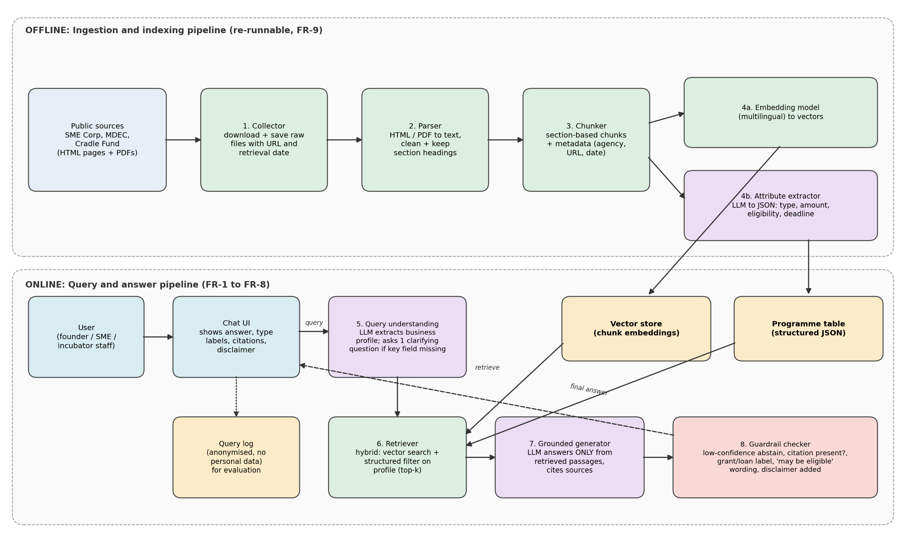

# GrantGuide: Week 2 V1 Architecture and Design Decisions

> Preliminary. V1 choices are starting points and will be revised based on evaluation results.

## 1. Architecture Overview

V1 has two pipelines.

**Offline ingestion (FR-9):** Public sources are downloaded with their URL and retrieval date, parsed from HTML or PDF into text, split into section-based chunks with metadata, and then indexed two ways: embeddings go into a vector store, and an LLM-based attribute extractor writes structured programme records (type, amount, eligibility, deadline) into a programme table.

**Online query (FR-1 to FR-8):** The chat UI sends the user's description to a query-understanding step that extracts a business profile and asks a clarifying question if a key field is missing. A hybrid retriever searches the vector store and filters using the structured programme table. A grounded generator answers only from retrieved passages and cites them. A guardrail checker then verifies citations, applies abstention, confirms grant/loan labels, and adds the disclaimer before the answer is shown. Anonymised queries are logged for evaluation.

**Proposed V1 stack (to be confirmed):** Python, a multilingual embedding model, a lightweight vector store, JSON for the programme table, a hosted LLM API, and a simple web chat interface.

## 2. Architecture Decisions

### AD-1: Use RAG instead of fine-tuning or a rule-based system

- **Decision:** Answer questions by retrieving passages from the curated corpus and generating from them.
- **Alternatives considered:** (a) Fine-tune a model on funding documents. (b) Hand-written eligibility rules. (c) Plain keyword search.
- **Why:** Programmes change often, so a retrieval index can be refreshed without retraining. Citations come naturally from retrieved passages. Rules and keyword search cannot interpret free-text business descriptions.
- **Trade-offs:** Answer quality depends on retrieval quality and on chunking. There is added latency and per-query cost. Complex multi-document reasoning may be weaker than with rules for exact thresholds.
- **Revisit if:** Retrieval recall (EV-1) stays below target after tuning.

### AD-2: Hybrid retrieval with a structured programme table

- **Decision:** Combine vector search over chunks with structured attributes extracted per programme (type, amount, eligibility, deadline), and filter or rank using the user's profile.
- **Alternatives considered:** Vector search only.
- **Why:** Eligibility depends on exact values (turnover caps, headcount, entity type) and on distinguishing grants from loans. Structured fields support filtering and consistent type labels, which pure semantic search handles unreliably.
- **Trade-offs:** More engineering effort, plus an extra LLM extraction step that can itself make errors and needs validation. The table must be rebuilt when documents change.
- **Revisit if:** Extraction accuracy (EV-5) is below target, in which case fall back to manual curation of the small V1 corpus.

### AD-3: Section-based chunking with metadata

- **Decision:** Split documents by headings and sections, and attach agency, programme name, source URL, and retrieval date to every chunk.
- **Alternatives considered:** Fixed-size token chunks.
- **Why:** Eligibility criteria are usually described under their own headings, so section chunks keep conditions together. Metadata is needed for citations (FR-5) and freshness display (FR-6).
- **Trade-offs:** Parsing is harder for messy HTML and PDFs, and chunk sizes vary. Some sections may be too long and need secondary splitting.
- **Revisit if:** Recall@5 (EV-1) is below target.

### AD-4: Guardrail layer with abstention before showing answers

- **Decision:** Add a separate checking step after generation. It verifies that claims are supported by cited passages, abstains when retrieval confidence is low, confirms grant/loan labels, and adds the disclaimer and "may be eligible" wording.
- **Alternatives considered:** Rely on the prompt alone to enforce these behaviours.
- **Why:** Prompts alone do not guarantee compliance. A separate step makes the Responsible AI requirements testable (EV-4, EV-6, EV-7).
- **Trade-offs:** More latency and cost, and a risk of over-refusal that hurts usefulness. The confidence threshold needs tuning.
- **Revisit if:** False abstention (EV-6) exceeds target or p95 latency (EV-10) exceeds 10 seconds.

## 3. Traceability Matrix

Maps requirements to architecture components, decisions, and evaluation criteria.

| Requirement | Architecture component | Decision | Evaluation criterion |
|-------------|------------------------|----------|----------------------|
| FR-1 Accept free-text input | Chat UI | AD-1 | EV-2 |
| FR-2 Profile extraction and clarifying question | Query understanding | AD-2 | EV-9 |
| FR-3 Retrieve passages | Retriever, vector store | AD-1, AD-2, AD-3 | EV-1 |
| FR-4 Candidate programmes with type | Programme table, grounded generator | AD-2 | EV-2, EV-5 |
| FR-5 Citations | Chunk metadata, grounded generator, guardrail | AD-3, AD-4 | EV-3 |
| FR-6 Source dates | Collector, chunk metadata, chat UI | AD-3 | EV-8 |
| FR-7 Abstention | Guardrail checker | AD-4 | EV-6 |
| FR-8 Disclaimer and wording | Guardrail checker, chat UI | AD-4 | EV-7 |
| FR-9 Re-runnable ingestion | Collector, parser, chunker, embedding, extractor | AD-3 | EV-12 |
| FR-10 Anonymised logging | Query log | AD-4 | EV-14 |
| NFR-1 Accuracy | Retriever, generator, guardrail | AD-1, AD-2, AD-4 | EV-2, EV-4 |
| NFR-2 Performance | Whole online pipeline | AD-1, AD-4 | EV-10 |
| NFR-3 Reproducibility | Ingestion pipeline, config | AD-3 | EV-12 |
| NFR-4 Maintainability | Modular pipeline stages | AD-1, AD-2 | Code review |
| NFR-5 Cost | LLM calls, extractor | AD-1, AD-4 | EV-13 |
| NFR-6 Usability | Chat UI, generator | AD-1 | EV-2 |
| NFR-7 Privacy | Query log, chat UI | AD-4 | EV-14 |
| RAI-1 Grounding | Grounded generator, guardrail | AD-1, AD-4 | EV-3, EV-4 |
| RAI-2 Abstention | Guardrail checker | AD-4 | EV-6 |
| RAI-3 Grant vs loan clarity | Programme table, guardrail | AD-2, AD-4 | EV-5 |
| RAI-4 No guarantees | Guardrail checker, chat UI | AD-4 | EV-7 |
| RAI-5 Freshness transparency | Chunk metadata, chat UI | AD-3 | EV-8 |
| RAI-6 Language and regional fairness | Embedding model, evaluation set | AD-1 | EV-11 |
| RAI-7 Data minimisation | Query log, chat UI | AD-4 | EV-14 |
